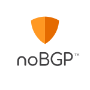
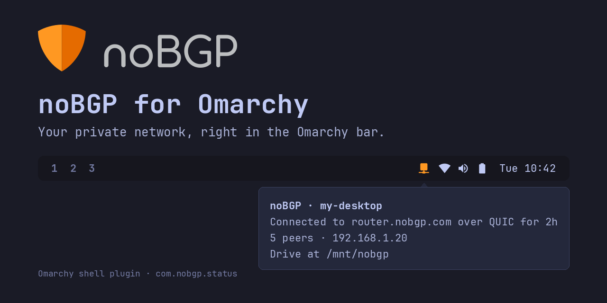

<p align="center"></p>

# noBGP for Omarchy



noBGP in your [Omarchy](https://omarchy.org) bar: connection state and peer count, with a click into the noBGP app for peers, services and what this machine shares. [noBGP](https://nobgp.com) puts your machines on a private network that is off the public internet: no open ports, no public DNS, reachable only by you, the people you share with, and your AI agents.

This repository is an Omarchy shell plugin (`com.nobgp.status`, a bar widget) plus the open-source noBGP app for Omarchy that it opens.

## Install

```bash
omarchy plugin add https://github.com/nobgp/omarchy-nobgp --enable
```

Or add it from the [Omarchy plugin marketplace](https://omarchyplugins.com), or from the Omarchy plugins list in My Own Data Center.

The noBGP icon appears in the bar. If this machine doesn't have noBGP yet, the icon says so: click it, and a terminal walks you through the two pieces the widget needs, showing every step and asking for your sudo password itself:

1. the **noBGP agent**: the terminal shows noBGP's official installer command and puts it on your clipboard, and you run it yourself (this plugin never downloads and runs code for you). It shows a sign-in link to add this machine to your account;
2. the **noBGP app** (`nobgp-omarchy`), from the AUR when it's there, otherwise built from the source in [`app/`](app/).

You can run the same installer yourself: `bash ~/.config/omarchy/plugins/com.nobgp.status/install.sh`. Adding the plugin runs nothing; Omarchy plugins have no install hook.

## Using it

- **Left click**: open the noBGP app (or install it, the first time).
- **Right click**: open the noBGP web console.
- **Middle click**: refresh.
- **`SUPER + SPACE → noBGP`**: Open, Peers, Services, This Device, Web Console, Log In, Restart Agent.

The refresh interval is a widget setting (default 30 seconds).

## What runs, and with what rights

The widget runs one command, `nobgp-omarchy bar`, and draws its JSON. The app drives the agent's own CLI (`nobgp … --json`). Reading the agent's status needs root, so the app package installs one sudoers rule letting the `wheel` group run exactly `nobgp status --json` without a password; every other privileged action asks for your password in a terminal you can see. Services and networks use your own `nobgp login`, not root.

## Remove

```bash
omarchy plugin remove com.nobgp.status
nobgp-omarchy setup --remove     # menu rows and the web console launcher
sudo pacman -R nobgp-omarchy     # the app
```

The agent has its own uninstaller; see the noBGP docs.

## License

The plugin and the noBGP app for Omarchy in this repository are released under the [MIT License](LICENSE). The noBGP agent and router they talk to are separate, proprietary products of noBGP, Inc., downloaded from noBGP when you install; they are not part of this repository or its license.

"noBGP" and the noBGP logos are trademarks of noBGP, Inc., and all rights in them are reserved. The MIT License does not grant permission to use them; see [TRADEMARKS.md](TRADEMARKS.md).

This repository is exported from noBGP's internal monorepo; issues and pull requests are welcome here.
